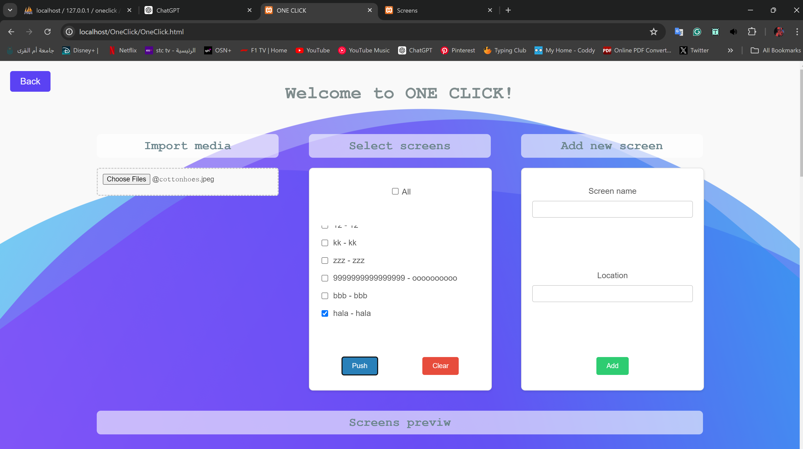
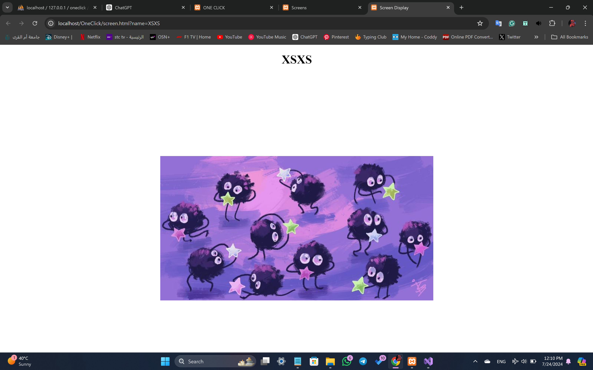
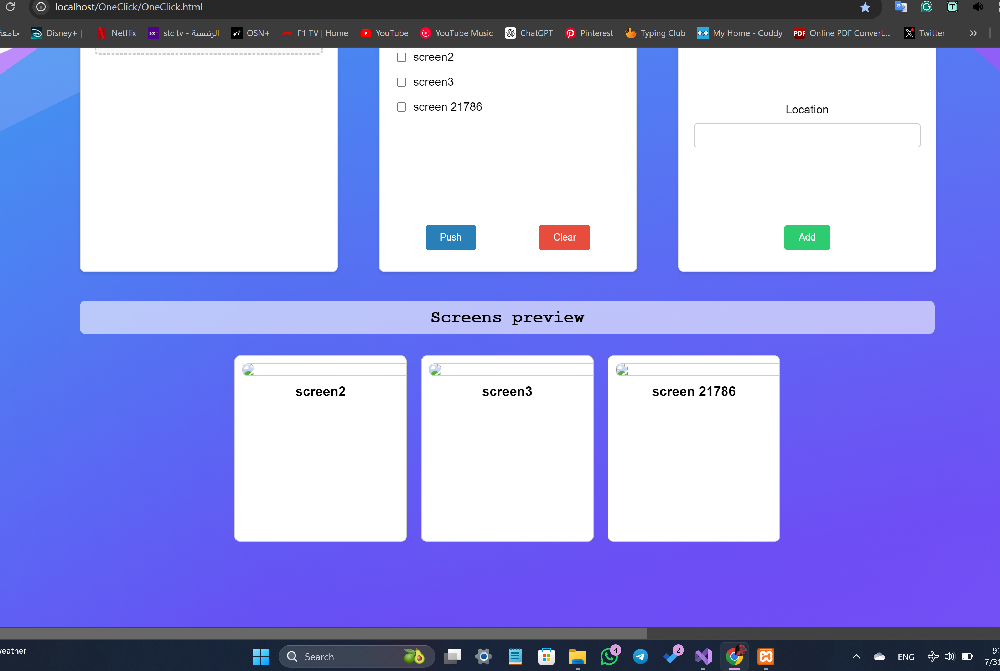

# OneClick – Synchronized Advertisement Screens

> A web control panel for pushing the same images or videos to several advertisement screens at once. Built with HTML, CSS, JavaScript, PHP and MySQL.

## Overview

OneClick was developed during summer training at **Medical Fakeeh** (2024) as a team project with other trainees. It lets staff register display screens, upload media, and push that content to selected screens with one click, so screens in different locations show the same content at the same time.

## Features

- **Login and roles:** the login page sends users to the Admin, Sub-admin or User home pages. Registration is handled by PHP with `password_hash`.
- **User management** (`usersList.html`): list users, change a role (admin / sub / user), delete a user
- **Screen management** (`OneClick.html`, `screensList.html`): add a screen with a unique name and IP/location, list screens and delete them. Data is stored in MySQL.
- **Media upload** (`importMedia.php`): upload images or videos to `uploads/` and record them in the `media` table
- **Push to screens:** choose one or more screens (or *All*) and push the selected media. Each screen opens `screen.html`, which shows the media full-screen and updates live.

## Tech Stack

- HTML5, CSS3, vanilla JavaScript
- PHP (mysqli) endpoints: `addScreen`, `getScreens`, `deleteScreen`, `getMedia`, `importMedia`, `register`, `login`, `getUsers`, `updateRole`, `deleteUser`
- MySQL database `oneclick` with tables `users`, `screens` and `media`
- XAMPP (Apache + MySQL) for local hosting

## How to Run

1. Install XAMPP and start Apache and MySQL.
2. Copy the project folder into `htdocs/OneClick/`.
3. In phpMyAdmin, create the database `oneclick` with these tables:
   - `users (id, username, email, password, role)`
   - `screens (screen_name, location, screen_url)`
   - `media (media_name, type, path)`
4. Open `http://localhost/OneClick/`. `index.html` is the login page.

The PHP files use XAMPP's default local credentials (`root` with no password).

## Project Structure

| Files | Purpose |
|---|---|
| `index.html`, `LogIn.js`, `LogIn.css` | Login |
| `registration.*`, `register.php` | Create users |
| `Amin1Home.html`, `SubAdmin.html`, `UserHome.html` | Role home pages |
| `OneClick.html/.js/.css` | Main panel: screens, media upload, push |
| `screensList.*`, `ScreensList.js` | Screens table |
| `usersList.*` | Users table and roles |
| `screen.html` | Full-screen media display for a screen |
| `*.php` | Backend endpoints |

## Screenshots

| Main control panel | Screen display | Screens preview |
|---|---|---|
|  |  |  |

Captured from the local XAMPP run (`localhost/OneClick/`) during summer training: media import + screen selection + push, a live `screen.html` display, and the screens preview strip.

## Documentation

Summer training report (student ID removed): [`docs/Summer_Training_Report.pdf`](docs/Summer_Training_Report.pdf).

## Credits

Developed during the Computer Science summer training (Umm Al-Qura University) at Medical Fakeeh, 2024, as part of teamwork with other trainees. **Hala Jalal** contributed as a team member.
